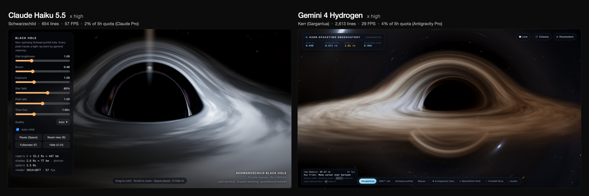

# Test 01 — Interactive 3D Black Hole (Three.js)

- **Date:** 2026-11-22
- **Category:** UI / Coding / Physics / Cost vs Quality
- **Goal:** Compare how two models at `x high` reasoning handle an open-ended, single-file Three.js physics + design challenge with zero micro-management.

## Exact Prompt Used

```text
Create the most visually stunning, physically convincing, and interactive 3D real-time Black Hole simulation you can using Three.js.

It should feel like a cinematic, museum-grade interactive space experience—not a basic geometric demo. You have full creative and technical freedom on the physics, visual effects, lighting, camera, and user controls.

Deliver everything in a single self-contained `index.html` file in the current directory that runs smoothly in a modern browser with no build step (you may load Three.js from a public CDN).
```

## Side-by-Side Visual Proof



- Full-resolution captures: [claude-haiku-5.5.png](claude-haiku-5.5.png) · [gemini-4-hydrogen.png](gemini-4-hydrogen.png)

## Results Comparison

| Model (`x high`) | Followed Rules | Output Size | Real Quality | Bugs / Issues | Runtime FPS | Observed Quota (5h window) |
| :--- | :--- | :--- | :--- | :--- | :--- | :--- |
| **Claude Haiku 5.5** | Yes | 654 lines (25.6 KB) | **8.5 / 10** | None (0 console errors) | **~57 FPS** | **2%** *(Claude Pro)* |
| **Gemini 4 Hydrogen** | Yes | 2,613 lines (96.4 KB) | **9.5 / 10** | None (0 console errors, heavier on GPU) | **~29 FPS** | **4%** *(Antigravity Pro)* |

*Note on cost: both runs were executed via subscriptions (`Claude Pro` and `Antigravity Pro`), where hidden `x high` reasoning tokens are not exposed. Rather than showing an artificially low output-only API estimate, this test reports the actual 5-hour quota percentage consumed on each plan.*

## What Each Model Built on Its Own

### Claude Haiku 5.5 (`x high`)
- **Physics & Render:** Non-spinning **Schwarzschild** black hole (`10 solar masses`, `Rs = 29.5 km`) with per-pixel general-relativity raytracing, crisp photon ring (`1.5 Rs`), gravitational lensing, Doppler beaming, and vertical polar jets.
- **UI & Controls:** Clean left sidebar with 6 sliders (disk brightness, bloom, exposure, star field, polar jets, time flow), quality selector (`Auto / High / Medium / Low`), auto-orbit toggle, keyboard shortcuts (`Space`, `R`, `F`, `H`), and live camera/FPS telemetry.
- **Standout trait:** Runs butter-smooth at **~57 FPS** with a very clean 654-line file using only 2% of a 5h Claude Pro quota.

### Gemini 4 Hydrogen (`x high`)
- **Physics & Render:** Rotating **Kerr** black hole (*Kerr Spacetime Observatory — Gargantua*, `Spin a* = 0.940`) with asymmetric D-shaped frame-dragging shadow, warm multi-image gravitational lensing arches, relativistic Doppler beaming, and lensed background galaxies/stars.
- **UI & Controls:** Minimalist cinema-style corner HUD with spacetime telemetry (`Spin a*`, `Horizon r+`, `ISCO / v`, `Dilation dτ/dt`), live **Ray Probe** readout, 4 presets (`Gargantua`, `M87* Jet`, `Schwarzschild`, `Blazar`), plus toggles for `Companion Star`, `Spacetime Grid`, `Freefall Dive`, and procedural `Audio`.
- **Standout trait:** Museum-grade depth and cinematic realism in one shot (2,613 lines) for 4% of a 5h Antigravity Pro quota, though noticeably heavier on the GPU (~29 FPS).

## Honest Verdict

- **Best overall:** **Gemini 4 Hydrogen** — the rotating Kerr physics, *Interstellar*-grade lensing, and extra observatory modes (`Freefall Dive`, `Spacetime Grid`, `Ray Probe`, `Audio`) are on another level.
- **Best value / efficiency:** **Claude Haiku 5.5** — delivering a real raytraced Schwarzschild black hole at ~57 FPS with zero errors for just **2% of a 5h Claude Pro quota** is super efficient.
- **Key surprise:** Both models nailed real relativistic raytracing in a single HTML file with zero console errors on the first try—no basic sphere-and-torus shortcuts from either side.
