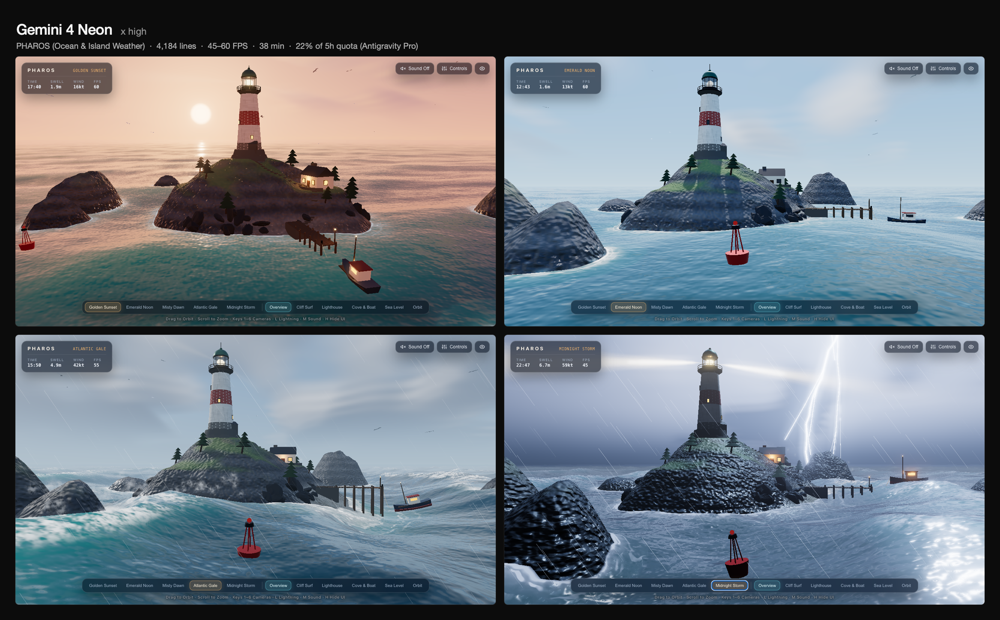

# Test 02 — Interactive 3D Ocean & Island Weather (Gemini 4 Neon Solo Showcase)

- **Date:** 2026-11-24
- **Category:** UI / Coding / Physics / Autonomous Visual QA
- **Goal:** Push a single frontier model (**Gemini 4 Neon**, `x high`) on an open-ended Three.js ocean, island, and dynamic weather showcase in one self-contained HTML file.

## Exact Prompt Used

```text
Create the most visually stunning, physically convincing, and interactive 3D real-time Ocean & Island Weather simulation you can using Three.js.

It should feel like a cinematic, atmospheric showcase—living waves, coastal terrain or a lighthouse, dynamic time of day, and shifting weather from calm sunset to full storm. You have full creative and technical freedom on the water shaders, physics, lighting, sound, camera, and user controls.

Deliver everything in a single self-contained `index.html` file in the current directory that runs smoothly in a modern browser with no build step (you may load Three.js from a public CDN).
```

## Visual Proof (4 Weather Presets)



- Full-resolution captures: [sunset.png](sunset.png) · [storm.png](storm.png)

## Measured Run Summary

| Model | Followed Rules | Output Size | Real Quality | Bugs / Issues | Runtime FPS | Generation Time | Observed Quota (5h window) |
| :--- | :--- | :--- | :--- | :--- | :--- | :--- | :--- |
| **Gemini 4 Neon (`x high`)** | Yes | 4,184 lines (163 KB) | **9 / 10** | None (0 console/WebGL errors) | **45–60 FPS** | **38 min** | **22%** *(Antigravity Pro)* |

## What Gemini 4 Neon Built on Its Own (**PHAROS**)

- **Multi-scale Gerstner Ocean (GPU + CPU synced):** 10-component directional wave spectrum with depth attenuation around the island (`512×512` shared heightmap), shallow Beer-Lambert refraction, turquoise subsurface scattering through backlit wave crests, Fresnel sky reflections, coastal surf foam, and wind streaks.
- **Full 24h Atmosphere & 5 Live Weather Presets:** Seamless transitions across `Golden Sunset`, `Emerald Noon`, `Misty Dawn`, `Atlantic Gale` (4.9 m swell, 42 kt wind, slanted rain), and `Midnight Storm` (6.7 m swell, 59 kt wind, 3D branching lightning bolts with flash + subtle camera shake).
- **Coastal Island & Living Details:** Masonry lighthouse with rotating volumetric dual Fresnel beams, keeper's cottage with glowing windows at dusk/storm, wooden pier, swaying coastal pines, seagulls, blinking buoy, and a fishing boat floating physically on the waves.
- **Procedural Web Audio:** Built-in zero-asset soundscape (ocean swell, surf, wind gusts, rain, foghorn, buoy bell, and distance-delayed thunder).
- **Autonomous Visual QA:** During the 38-minute run, the model launched a local server and ran **3 visual inspection passes in the browser**—catching and fixing its own `NaN` boat-hull bloom artifact, sunset overexposure, and camera framing before finishing.

## Honest Verdict

- **What impressed most:** The sheer ambition and finish inside a single zero-build HTML file—real 60 FPS waves, smooth weather transitions, volumetric lighthouse beams, 3D lightning, procedural audio, and autonomous visual self-debugging with **zero console errors**.
- **Honest trade-offs:** Taking **38 minutes** and **22% of a 5h Antigravity Pro quota** is a heavy run for a single prompt (driven by the 3 browser QA passes), and up close the volcanic rocks still look slightly stylized/faceted compared to the water shader.
