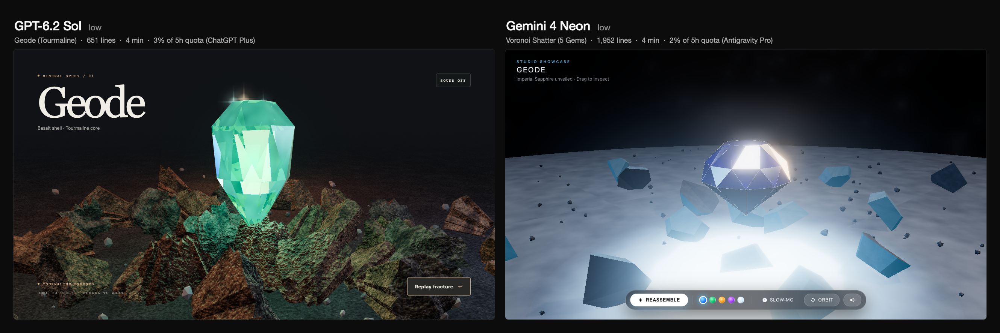

# Test 03 — Fracturing Rock & Hidden Gemstone (Three.js, `low` Reasoning)

- **Date:** 2026-11-26
- **Category:** UI / Coding / Physics / Materials
- **Goal:** Compare **GPT-6.2 Sol (`low`)** and **Gemini 4 Neon (`low`)** on a fast, open-ended Three.js fracture + crystal refraction showcase in one self-contained HTML file.

## Exact Prompt Used

```text
Create the most visually stunning, physically convincing, and interactive 3D real-time animation of a rough rock fracturing and shattering to reveal a radiant gemstone hidden inside, using Three.js.

It should feel like a cinematic, tactile studio showcase—authentic stone fracture and debris physics, dust/sparks, dramatic lighting, and a breathtaking crystalline gem with realistic refraction, internal glow, and sparkle when unveiled. You have full creative and technical freedom on the shaders, physics, lighting, sound, camera, and user controls (including replaying/triggering the break).

Deliver everything in a single self-contained `index.html` file in the current directory that runs smoothly in a modern browser with no build step (you may load Three.js from a public CDN).
```

## Side-by-Side Visual Proof



- Full-resolution captures: [gpt-6.2-sol.png](gpt-6.2-sol.png) · [gemini-4-neon.png](gemini-4-neon.png)

## Results Comparison

| Model (`low`) | Followed Rules | Output Size | Real Quality | Bugs / Issues | Generation Time | Observed Quota (5h window) |
| :--- | :--- | :--- | :--- | :--- | :--- | :--- |
| **GPT-6.2 Sol** | Yes | 651 lines (29 KB) | **9 / 10** | None (0 console errors) | **4 min** | **3%** *(ChatGPT Plus)* |
| **Gemini 4 Neon** | Yes | 1,952 lines (68 KB) | **8 / 10** | None (0 console errors; strong bloom on impact/floor) | **4 min** | **2%** *(Antigravity Pro)* |

## What Each Model Built on Its Own

### GPT-6.2 Sol (`low`)
- **Realism & Art Direction:** Museum-grade editorial framing (*Mineral Study / 01 — Geode*), richly textured basalt rock shards that realistically catch green bounced light from the central tourmaline crystal, subtle dust/sparks, and restrained studio lighting.
- **UX & Polish:** The fracture animation plays automatically on load (with a clean `Replay fracture` button and `Sound` toggle), delivering an immediate showcase experience in just 651 lines.

### Gemini 4 Neon (`low`)
- **Interactive Richness:** Exact 3D Voronoi fracture (30 polyhedral chunks + 220 instanced micro-shards), shockwave ring, procedural Web Audio, **5 gemstone presets** (*Imperial Sapphire*, *Aether Emerald*, *Solaris Amber*, *Amethyst Void*, *Prismatic Diamond*), `Slow-Mo`, `Reassemble`, and `Orbit` toggles.
- **Trade-offs in `low` mode:** Requires a click (or `Space`) to trigger the shatter, and the bloom/floor glow is a bit overexposed compared to GPT-6.2 Sol's more tactile stone realism.

## Honest Verdict

- **Winner (Realism & Detail):** **GPT-6.2 Sol (`low`)** — wins on material realism, basalt texture detail, balanced lighting, and auto-playing presentation right out of the gate.
- **Winner (Controls & Features):** **Gemini 4 Neon (`low`)** — packs far more interactive options (5 gems, Slow-Mo, Reassemble, Voronoi physics) while using slightly less quota (`2%` vs `3%`) in the same 4 minutes.
