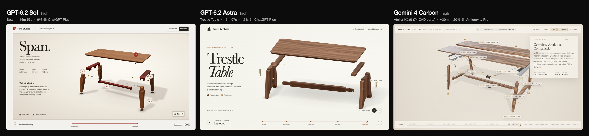

# Test 04 — Scroll-Driven 3D Exploded View of a Designer Table (Three.js, `high` Reasoning)

- **Date:** 2026-11-26
- **Category:** UI / Coding / 3D Mechanical Logic / Design
- **Goal:** Compare **GPT-6.2 Sol (`high`)**, **GPT-6.2 Astra (`high`)**, and **Gemini 4 Carbon (`high`)** on an open-ended, single-file Three.js exploded-view engineering & product design showcase driven by scroll.

## Exact Prompt Used

```text
Create the most visually stunning, mechanically convincing, and interactive 3D scroll-driven Exploded View of a designer table using Three.js.

At the top of the page, the table is fully assembled with real structural logic—every component fits together cleanly with no floating or clipping parts. As the user scrolls down, the table smoothly disassembles into an exploded view, separating all its parts (tabletop, legs, stretchers, joinery, brackets, fasteners, etc.) along physically logical assembly axes, and reassembles smoothly when scrolling back up.

It should feel like an editorial, museum-grade industrial design showcase—authentic materials, studio lighting, crisp typography, smooth camera choreography, and optional interactive inspection. You have full creative and technical freedom on the table design, joinery engineering, shaders, camera, and controls.

Deliver everything in a single self-contained `index.html` file in the current directory that runs smoothly in a modern browser with no build step (you may load Three.js from a public CDN).
```

## Side-by-Side Visual Proof



- Full-resolution captures (100% exploded): [gpt-6.2-sol.png](gpt-6.2-sol.png) · [gpt-6.2-astra.png](gpt-6.2-astra.png) · [gemini-4-carbon.png](gemini-4-carbon.png)
- 16:9 HD showcase video with smooth transitions (31.4s): [compare.mp4](compare.mp4)

## Results Comparison

| Model (`high`) | Project | Followed Rules | Output Size | Real Quality | Bugs / Issues | Generation Time | Observed Quota (5h window) |
| :--- | :--- | :--- | :--- | :--- | :--- | :--- | :--- |
| **GPT-6.2 Sol** | *Span* | Yes | 1,100 lines (51 KB) | **8.5 / 10** | None (0 console errors) | **14m 53s** | **9%** *(ChatGPT Plus)* |
| **GPT-6.2 Astra** | *Trestle Table* | Yes | 492 lines (638 KB) | **8.5 / 10** | None (0 console errors; heavy quota usage) | **15m 07s** | **42%** *(ChatGPT Plus)* |
| **Gemini 4 Carbon** | *Atelier Kōzō* | Yes | 4,186 lines (152 KB) | **9.5 / 10** | None (0 console errors; ~2× slower) | **~30m** | **20%** *(Antigravity Pro)* |

## What Each Model Built on Its Own

### Gemini 4 Carbon (`high`) — *Atelier Kōzō · Table No. 04*
- **Mechanical Depth:** **74 precision CAD parts** across 18 references (`KZ-01` to `KZ-18B`), including book-matched walnut slabs with 3 flush brass butterfly keys (*chigiri*), cast-aluminum expansion yokes, M8 cap screws + Belleville washers, diagonal turnbuckle struts, bronze center saddle, `6°` tusk wedges, and `10°` splayed legs with coaxial glides.
- **Interactive Tools:** Dynamic dotted assembly **Axes**, clickable `BOM [74]` bill of materials with group isolation, **X-Ray** CAD wireframe mode, **Callouts**, and **Obsidian** dark studio theme.
- **Trade-off:** Roughly **2× slower (~30 min)** than the GPT-6.2 models, though the jump in detail is immediately visible.

### GPT-6.2 Sol (`high`) — *Span*
- **Design & Efficiency:** Clean editorial showcase (*Form Studies*) featuring an oiled walnut top, oxide-red steel trestles and central spine, fasteners/inserts, numbered callouts (`01`–`05`), and a dedicated `Inspect` orbit mode—all in 1,100 lines for only **9% of a 5h ChatGPT Plus quota**.

### GPT-6.2 Astra (`high`) — *Trestle Table*
- **Material & Editorial Polish:** Gorgeous black walnut grain, sculpted arched trestles, through-tenon stretcher locked by tapered satin-brass keys, and a clean 5-step timeline (`Whole → Fasteners → Tabletop → Joinery → Exploded`).
- **Trade-off:** Consumed **42% of a 5h ChatGPT Plus quota** on a single prompt—nearly 5× more than GPT-6.2 Sol for a comparable level of mechanical complexity.

## Honest Verdict

- **Winner (Overall & Mechanical Detail):** **Gemini 4 Carbon (`high`)** — even at ~2× the generation time (~30 min), the leap in CAD precision (74 parts, butterfly keys, turnbuckles, assembly axes, BOM, X-Ray) clearly sets it apart.
- **Best Efficiency / Quota Value:** **GPT-6.2 Sol (`high`)** — crisp, solid, zero-bug execution in under 15 minutes for just **9%** of a 5h quota.
- **Most Refined Classic Look:** **GPT-6.2 Astra (`high`)** — lovely wood texture and editorial feel, though its 42% quota cost is tough to justify next to Sol and Carbon.
